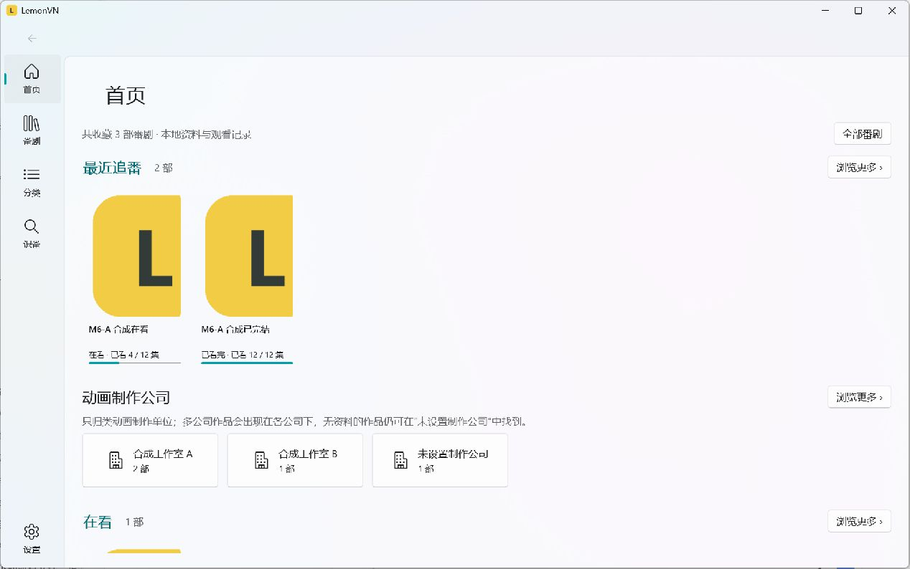

# LemonVN

项目主页：[38huangyukong38/Lemonvn](https://github.com/38huangyukong38/Lemonvn)。默认分支 main；首次公开源码提交为5eb46a0。本地M6-B2-B1更新待审，当前没有公开二进制发行。

LemonVN 是 Windows 桌面的轻量番剧收藏与追番记录库，基于 [GoldenPotato137/PotatoVN](https://github.com/GoldenPotato137/PotatoVN) 的 WinUI 3 框架改造，采用 MVVM 与 LiteDB。本项目是独立修改版，与 PotatoVN 官方服务、商店发行和签名无关。

**当前状态：V0.1 内部候选已完成本机部署验证，等待用户审核，尚无公开下载。不要下载 PotatoVN 安装包来代替 LemonVN。** 开源仓库与二进制公开前仍需完成 [GitHub 安全审查](docs/GITHUB_OPEN_SOURCE_AUDIT.md) 和 [发布检查表](docs/RELEASE_CHECKLIST.md)。

## 功能

- 完全离线手动添加、编辑、收藏、回收站恢复；搜索、状态/个人标签/制作公司筛选及排序。
- 首页最近追番与状态分区、制作公司分类、封面墙和详情；浅色/深色主题。
- 想看、在看、已看完、搁置、抛弃五种状态；个人评分、备注和标签。
- 简单进度、+1、批量标记和逐集记录。已看数量只由 EpisodeRecord 计算；+1 标记编号最小的未看正片，观看状态独立控制。
- 主动搜索 Bangumi 公开动画资料，人工预览后添加/关联/刷新；保留手动保护字段和个人观看记录，无需 Access Token。
- Trace.moe 截图识别、AnimeTrace 角色识别；选择图片不会上传，明确确认后才发送，结果需人工核对，可主动转到 Bangumi。
- ZIP 完整备份与安全恢复：收藏、回收站、个人记录和引用封面。读取 V1/V2、导出 V2。

**不提供视频播放、视频下载、资源搜索、文件扫描、账户同步或云端收藏服务。**

## 界面

下图为 LemonVN 自有占位封面和合成收藏，不含真实用户记录或第三方动画截图。

## Windows 与运行

首发目标为 Windows x64。目前仅实测 Windows 11 10.0.26200 x64；工程最低声明 10.0.17763 不代表所有 Windows 10 设备已经验收。MSIX、正式签名和自动更新未提供。

.NET 8 运行时随当前候选目录提供；**Windows App Runtime 仍需在当前用户下安装兼容的 x64 版本**。当前构建使用 Windows App SDK 2.1.3，框架家族和最低版本见候选内 runtime-requirements.json。完整解压 ZIP，运行 LemonVN.exe，不要只复制 EXE 或直接在压缩软件内运行。详细操作见 [安装与使用](docs/INSTALLATION_GUIDE.md)。

候选仅供维护者个人本地研究测试，未完成公开分发准入；它不是正式发行版。独立仓库已由维护者创建；未来发行地址为 [GitHub Releases](https://github.com/38huangyukong38/Lemonvn/releases)，当前没有正式公开二进制发行，不应将此链接理解为已有下载。

## 数据与备份

非打包版默认保存到 `%LocalAppData%\LemonVN`，数据库为 lemonvn.db，封面/设置/备份/日志也在专属目录。ZIP 是免安装程序分发形式，**不是数据随 EXE 移动的真正便携模式**。

在设置中导出备份；恢复会替换当前收藏与回收站，先校验、再确认，执行前保存安全恢复副本。升级前导出完整备份，正常关闭旧程序，将新程序解压到新的目录；不要清理个人数据目录。已验收的旧 ZIP V1/V2 可恢复，新版公司字段不支持降级编辑。ZIP 不包含设置，主题需要在另一运行模式下重新选择。

## 隐私与第三方服务

本地收藏无需网络。Bangumi 查询发送关键词/条目 ID；识番确认后向所选 Trace.moe 或 AnimeTrace 发送去元数据的 JPEG 副本，不发送原路径、文件名、收藏或观看记录。第三方会接收网络信息并按其政策处理请求，取消不能撤回已发送内容。识别结果不会自动入库或修改进度。

没有 Token 保存、账户、遥测上传或云同步。断网/API 限额时本地管理仍可使用。详见 [隐私说明](docs/PRIVACY.md)。

服务归属：Bangumi、Trace.moe、AnimeTrace 均由各自运营者维护，LemonVN 不提供可用性保证。Trace.moe 未经明确批准不得用于商业目的；AnimeTrace 允许受条件约束的即时 API 调用，禁止未经许可的规模抓取。API 权利不包含作品图像的版权。详见 [API 与许可证风险](docs/API_AND_LICENSE_RISKS.md)。

## 开发与当前限制

使用 C# / .NET 8 / WinUI 3，客户端项目仍位于 GalgameManager。构建步骤与运行时说明见 [安装与开发说明](docs/INSTALLATION_GUIDE.md)，仓库规范见 AGENTS.md。仅为本地构建时不需要签名证书，不应运行上游发布工作流。

内部候选整理脚本使用 Python 3.12+ 标准库；它是开发工具，不随 ZIP 分发，运行 LemonVN 不需要 Python。

M6-B2-B1已在本地移除客户端AutoMapper/SevenZipSharp并整理版本化许可资料；仍有包许可范围和SDK再分发条款待确认。源码快照与二进制的准入分别记录在 [首次源码审查](docs/M6_B2A_OPEN_SOURCE_CLEARANCE.md)，本轮没有获得Push或公开ZIP授权。尚未验证干净机器、其他 Windows 版本、全部 DPI、MSIX 安装升级。日文新增文案存在英文回退。详见 [V0.1 说明](docs/RELEASE_NOTES_0.1.md)。

## 致谢与许可证

感谢 GoldenPotato137 及 PotatoVN 的全部贡献者。LemonVN 的上游基线为 2adef493ea0d82d27d4037e91507e558c567305d，保留原 [LICENSE](LICENSE) 和 [NOTICE](NOTICE)；修改记录见 [开发日志](docs/IMPLEMENTATION_LOG.md)。不继承 PotatoVN 的 SignPath、商店、账号、赞助或品牌授权。

LemonVN 应用代码沿用 **Apache-2.0**，保留原作者版权和适用第三方条款。当前免费、个人非商业维护是项目运营目标，**不是对 Apache-2.0 代码增加商业使用禁令**。第三方库、服务、字体、数据和图像仍按各自条款处理；Apache-2.0 不替它们授予权利。完整状态见 [第三方声明](THIRD_PARTY_NOTICES.md)。
